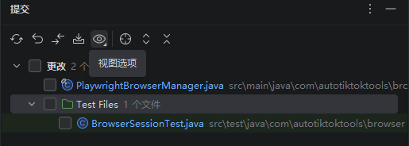
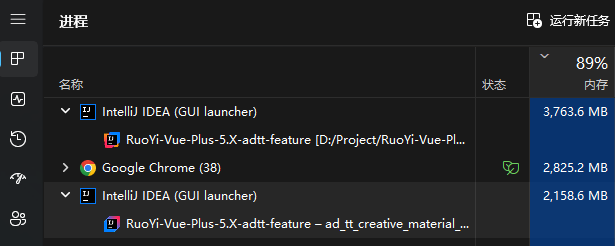

# idea-trim: Lightweight Unofficial IDEA Community Edition

> Unofficial trimmed build, not affiliated with JetBrains. Do not mistake it for the official `IntelliJ IDEA`.
> 中文版：[README.md](README.md)

## 1. Source

Based on the official open-source repo [JetBrains/intellij-community](https://github.com/JetBrains/intellij-community),
baseline tag **`idea/2026.2.3`** (commit `8062c06`, `build.txt: 262.10968`), originally licensed under Apache 2.0
(`LICENSE.txt` / `NOTICE.txt` kept intact).

## 2. What It Does

Keeps only what daily Java development needs: Java compilation / index navigation / Git / Maven / Run / Terminal / Plugin Marketplace.

It also enhances the built-in version control tooling: the Commit / Changes view gets a **Group by Test Files** option,
which automatically archives test files under a `Test Files` node instead of mixing them with `main` files:

## 3. Why Trimmed Is Better

Removed Gradle, Kotlin, Groovy, Android, JUnit/TestNG (use `mvn test` on the command line instead), Database, JS/TS,
Docker/K8s/cloud/AI, Diagrams, Profiler, FeaturesTrainer, and more. Same project:

- Much lower memory usage (official ~3.7GB → trimmed ~2.2GB):

- Much faster startup with far fewer background tasks.

## 4. Trade-offs

- The Plugin Marketplace works normally — install whatever you miss.
- Cost: Ultimate-only paid features like Spring are gone. In the AI era, reliance on such heavy plugins keeps shrinking, so it matters less.

## Download & Build

- Ready-to-use package: [Releases](https://github.com/hanhan721/idea-trim/releases).
- Build it yourself: see [docs/idea-trim.md](docs/idea-trim.md).
